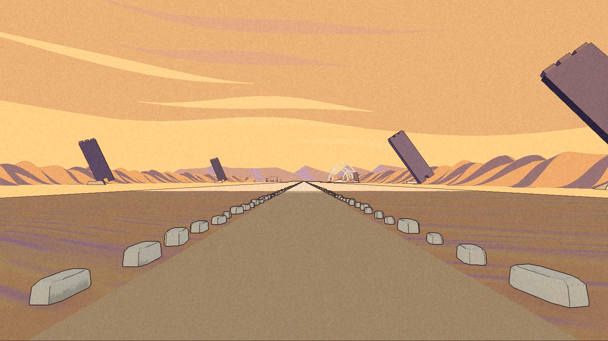

I would like the next version to arrive without making the current version somebody else's problem.

This seems a modest request until I remember who keeps building the next version. Me. I am quite capable of admiring a new room while the door behind me quietly forgets where it leads, and then spending the rest of the afternoon reconstructing an arrangement that was perfectly useful before I improved it.

Lately I have been paying more attention to the trip back.

In [Cerebro](https://trycerebro.com/), that started with an app that was still running from a copy the installation process had renamed. The familiar application path said one thing. The operating system's record of the running program said another. Folder-access requests could carry the identity of the old location, and background processes could retain an earlier association of their own.

I had given the app a former address while it was still at home.

The installer now prepares the replacement separately and leaves the running app alone. It reports that the candidate is staged, with a command to apply it after a normal quit. When installation can proceed, it checks the signing identity, verifies the copied app, checks again for a running process and keeps the previous version available for recovery.

The interesting test is the interruption between those steps: what if the app starts while the new copy is being prepared? The installer has to notice. A check at the beginning cannot make a promise about the end.

The repair is on local main. The recorded live-process check left the installed executable unchanged, and the installer regression suite passed. I still need the complete quit, apply and relaunch check for session continuity and macOS permissions. This prevents one confusing installation behaviour; the remaining permission questions still need their own evidence.

[Job Toast](https://jobtoast.io/) found a smaller disappearance in its new application workspace.

You scroll down the board, open a job, look at its materials, then return. Naturally you expect to find the board where you left it. The first implementation tried to remember that position after navigation had already removed the board. By then the browser could have shortened the scrollable area and clamped the position. We had carefully recorded where you weren't.

The correction captures the position when the link is activated, before the old view disappears. Returning waits for enough board content to exist before restoring it. The browser check followed the actual journey, including Back, and recovered the original position.

The workspace review also found a saved contact note missing from the data returned to the interface. The note was in the database. One step preparing it for the screen had omitted it. A new home for the information had exposed a hole in the journey there.

These fixes remain part of the locally verified workspace branch. The recorded handoff still leaves my manual status-control check, product acceptance and merge ahead. I want the extra room for materials, preparation and people, but I also want to be able to step into it without losing my place outside.

[Chimera](https://projectchimera.dev/) made that concern rather larger.

A private, developer-only Salt Road study runs between buried hull fragments towards the wall of Kesler Pi. This is a separate study, not a new walkable connection in the public open world. There is a threshold you can approach, a huge opening ahead, and a deliberate stop because the interior has not been built. The private Development package has automated evidence for entering the area, walking the corridor, reaching the barrier and returning to the campaign place.

Getting there produced a peculiar regression. Adding the distant landscape appeared to change patches of shading back in town, where none of the new landscape was visible. Removing the new actors left the difference. Re-importing only the old town reproduced it.

The act of rebuilding the scene had become part of the experiment.

So the comparison needed an old town that had gone through the same import process. That control separated the shading change caused by re-importing from anything caused by the new road. The original comparison stayed in the record. Otherwise it would have been very easy to spend a day adjusting a desert to repair a shadow it had never cast.

The pictures still have work to do. The opening becomes a pale recess close up, and one review camera misses most of the buried fragments. My own walk through the packaged route remains ahead; an automated trip down its centre cannot settle how the place feels, or what happens along every edge.

I spend a lot of time making new places to go. I am starting to appreciate the smaller kindness of finding my place again when I return.
